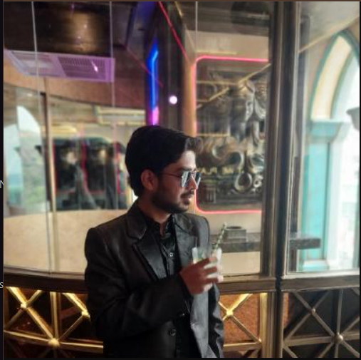

# // SAURAV.SYS — Autonomous Systems & Offensive AI Portfolio

  <strong>Offensive Security Researcher & Autonomous AI Systems Architect</strong>

  

 

  

> *"I architect offensive AI security systems and autonomous verification pipelines that operate 24/7 with zero false-positives, semantic reasoning, and continuous threat adaptation — built from first-principles, not fragile frameworks."*

---

## 🛰️ System Overview

Welcome to my personal portfolio and technical interface. I engineered this platform from the ground up as a high-density, cyberpunk-brutalist command terminal that showcases my work in **offensive security research (VAPT)**, **multi-agent AI orchestration**, and **industrial machine learning pipelines**.

Rather than a static resume page, the portfolio functions as a live interactive system reflecting my first-principles engineering philosophy.

---

## ⚡ Key Showcase Features

### 1. In-Browser Ambient Cyber Synthesizer
* Built a custom **Web Audio API sound engine** directly into the interface.
* Generates a dynamic low-frequency ambient cyber drone with real-time oscillator detuning, low-pass filter sweeps, and tactile auditory feedback (blips, toggles, confirmation chirps) with zero external audio dependencies.
* Fully interactive audio toggle switch with animated frequency visualizers.

### 2. Autonomous Core HUD & Radar Scanner
* Live targeting visualizer with continuous sweeping radar sweeps, crosshairs, and real-time telemetry tracking (`12ms latency`, `24 MCP nodes`).
* Interactive hardware switches allowing visitors to toggle system states:
  * `MCP Multi-Agent Bus` [ONLINE / BYPASS]
  * `Autonomous Pentest Triage` [ENGAGED / PAUSED]
  * `Local Zero-Cloud Inference` [ACTIVE / CLOUD]

### 3. Interactive 7-Layer Architectural Stack Inspector
* A deep inspection module showcasing **MASE** (my Multi-Agent Autonomous Penetration-Testing Framework).
* Interactive layer tabs (`L1: Cognitive Foundation` through `L7: Automated Remediation`) dynamically update the telemetry view with specifications, execution constraints, and proof-of-concept models.

### 4. Categorized Systems Matrix
* A filterable capability grid covering my security disclosures, engineering systems, and research tools:
  * **Cybersecurity & VAPT** (PTES, OWASP Top 10, CWE/CVSS scoring)
  * **AI & Security Automation** (MCP servers, AST code taint analysis)
  * **Machine Learning & Data** (Industrial ML, SHAP explainability)

### 5. Interactive Dispatch & Telemetry
* One-click clipboard copy utility for my direct contact email with interactive confetti particle bursts and audio verification.
* Real-time UTC telemetry ticker and reactive constellation particle canvas that responds dynamically to mouse coordinates.

---

## 🛡️ Featured Projects & Flagship Deployments

### 🔹 MASE — 7-Layer Autonomous Penetration-Testing Ecosystem
A persistent, self-evolving offensive security framework operating across web applications and API surfaces. Engineered with Model Context Protocol (MCP) compatible interfaces, featuring **478 specialized sub-agents** across **24 MCP tool servers**, 7-layer memory hierarchy, and continuous non-destructive exploit verification.

### 🔹 GetCodeChecked — AI Static Code Security Analyzer
An AI-assisted static code analyzer leveraging LLM-based semantic reasoning to detect hardcoded secrets, injection sinks, and broken access controls. Maps findings to OWASP Top 10 and CWE classifications with severity ratings and automated remediation patches.

### 🔹 Tata Motors — Industrial Assembly ML Pipeline
An end-to-end XGBoost machine learning pipeline predicting assembly-line time loss across **15,000+ vehicle passages** and **40+ stations** (**3.94-min MAE, 0.82 R²**). Developed station-level complexity features and a 5-page Streamlit dashboard supporting **60% lower line downtime** and **55% faster response times**.

### 🔹 BizPulse — AI Business Analytics SaaS
A full-stack SaaS platform converting raw accounting exports into structured, analytics-ready datasets. Integrates Claude AI to generate comprehensive PDF financial audits in under 60 seconds with intelligent response caching.

---

## 🎯 Bug Bounty Disclosures & Honors

* **HackenProof (ZCNode-32)**: Uncovered hardcoded private keys in a public repository enabling unauthorized token transfers on mainnet. Responsibly disclosed and resolved.
* **HackenProof (1INDEV-22)**: Reported an unauthenticated Sentry log injection vulnerability on `1inch.dev` allowing telemetry spoofing and data poisoning.
* **YesWeHack (398243)**: Identified an open redirect flaw in the EZVIZ OAuth authorization sequence with authorization code hijacking potential (CVSS 7.4).
* **IIT Guwahati CYLO Cybersecurity Hackathon (Finalist, Oct 2024)**: Built a secure messaging application featuring MFA, RootBeer root detection, reCAPTCHA v3 bot mitigation, and ProGuard bytecode obfuscation.
* **IETE Leadership**: Co-organized the Byte Buildathon (43-team national hackathon) and led the Connectothon hardware architecture workshop for 60+ engineers.

---

## 🛠️ Technical Arsenal

| Domain | Core Competencies & Tooling |
| :--- | :--- |
| **Offensive Security** | VAPT (PTES), OWASP Top 10, Burp Suite, Nmap, Metasploit, Frida, MobSF, Docker, Kali Linux |
| **Vulnerability Analysis** | IDOR/BOLA, SQL/NoSQL Injection, SSRF, XSS, Business Logic Bypasses, CVSS v3.1 Scoring |
| **Security Automation & AI** | MCP (Model Context Protocol), Multi-Agent Pentest Frameworks, Hugging Face, AST Parsing, Claude AI |
| **Blue Team & SOC** | SIEM (Splunk, Wazuh, ELK Stack), MITRE ATT&CK, Alert Triage, Threat Detection |
| **Machine Learning** | XGBoost, SHAP Explainability, Supervised Learning, Pandas, Streamlit |
| **Full-Stack & Languages** | Python, JavaScript (ES6+), React, Tailwind CSS, Node.js, C/C++, SQL, Shell Scripting |

---

## 📡 Connect & Dispatch

I am open to offensive security research opportunities, autonomous AI agent architecture engagements, and mission-critical engineering collaborations worldwide.

* 🌐 **Live Portfolio**: [sk4saurav.github.io/portfolio](https://sk4saurav.github.io/portfolio/)
* 🐙 **GitHub**: [@Sk4saurav](https://github.com/Sk4saurav)
* 💼 **LinkedIn**: [saurav-kumar-a62b63280](https://www.linkedin.com/in/saurav-kumar-a62b63280/)
* 📧 **Direct Email**: [sk4saurav@gmail.com](mailto:sk4saurav@gmail.com)

 

  OPERATOR: SAURAV KUMAR // SYSTEM HEALTH: 100% NOMINAL // LATENCY: 12ms

